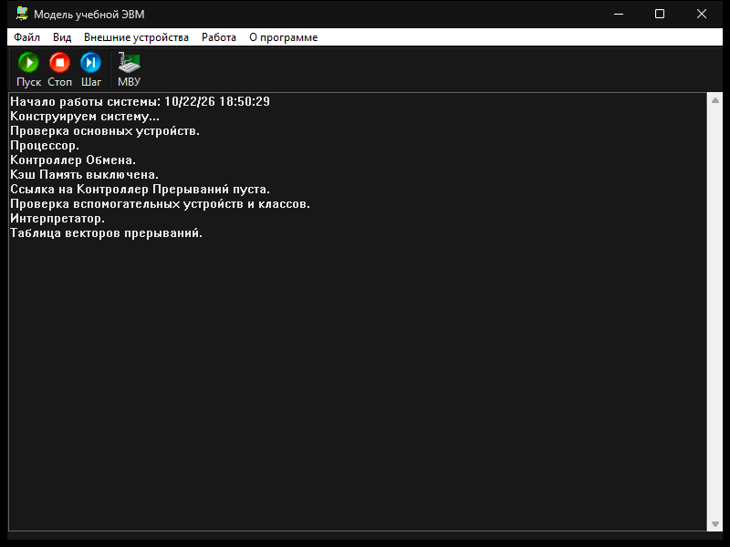
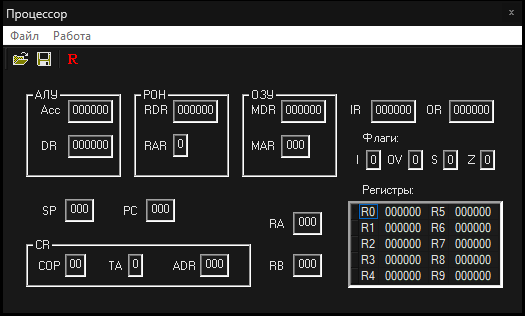

# Модель учебной ЭВМ

Учебная программа «Модель учебной ЭВМ» с восстановленными русскими подписями и тёмным оформлением. Команды, регистры и схема процессора те же, что в лабораторной работе.

Патч: **egoboris25**, 22 октября 2026.

## Скачать

**[Скачать CompModel.exe](https://github.com/egoboris25/CompModel_new_patch_2026-/raw/refs/heads/main/CompModel.exe)**

Один файл, около 500 КБ. Устанавливать ничего не нужно: скачайте и откройте двойным щелчком.

| Система | Как запустить |
| --- | --- |
| Windows 10 (версия 1903 и новее) и Windows 11 | Двойной щелчок по `CompModel.exe`. Подходит и 32-битная, и 64-битная система. |
| Linux через Wine | `wine CompModel.exe`. Нужен 32-битный Wine 8 или новее. |

На Windows 10 тёмная полоса заголовка может остаться системной. Сами окна, журнал и схема процессора тёмные.

## Как выглядит

## Что изменено

- Снова читаются подписи окон, кнопок и журнала.
- Окна оформлены в тёмных тонах.
- В «О программе» есть отметка об этом патче.

Автор исходной модели: Жмакин И.А., 2005.
